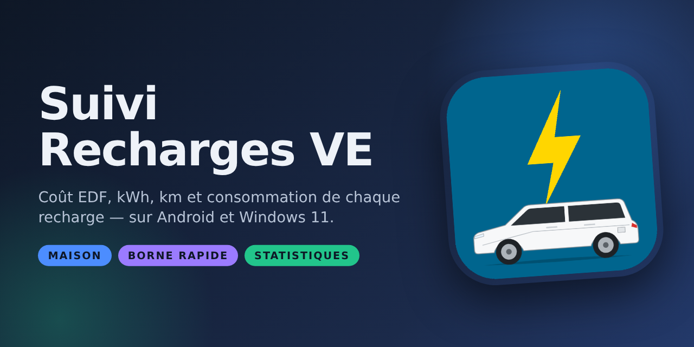
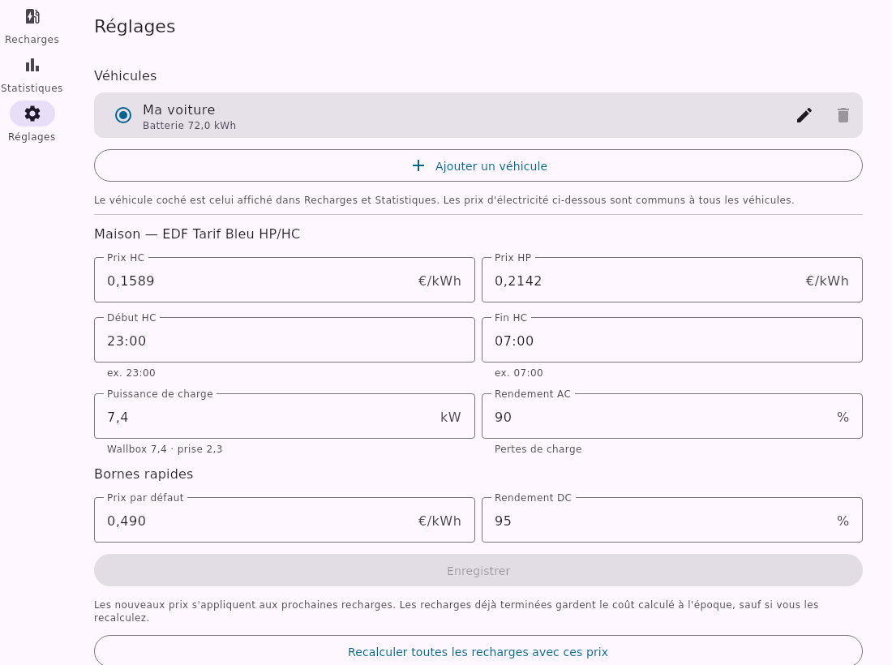
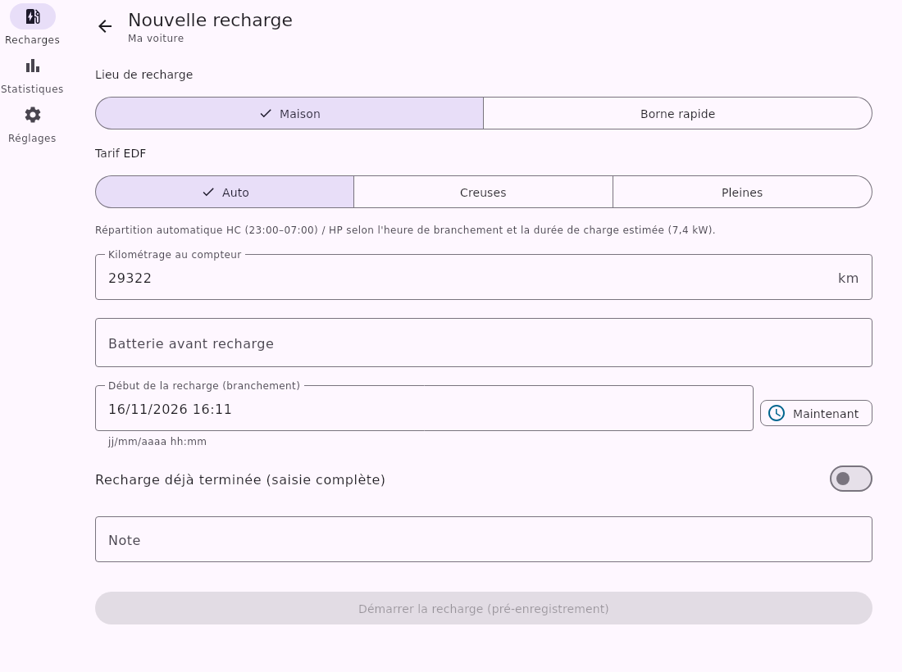
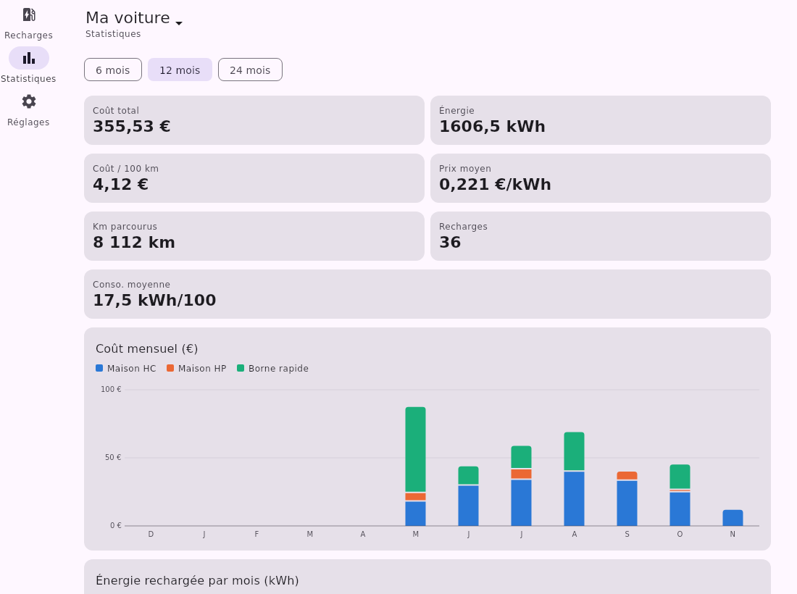

# Mode d’emploi — Suivi Recharges VE

<p align="center"></p>

Suivi Recharges VE note chaque recharge de votre voiture électrique et calcule son coût, l’énergie rechargée, les km parcourus et la consommation. Elle existe pour **Android** et **Windows 11**, avec les mêmes écrans.

**Sommaire**

1. [Installer l’application](#1-installer-lapplication)
2. [Premiers réglages](#2-premiers-réglages)
3. [Connecter la voiture (Hyundai, Kia, Genesis)](#3-connecter-la-voiture-hyundai-kia-genesis)
4. [Connecter la borne Legrand Green’Up Home](#4-connecter-la-borne-legrand-greenup-home)
5. [Une recharge à la maison](#5-une-recharge-à-la-maison)
6. [Une recharge sur borne rapide](#6-une-recharge-sur-borne-rapide)
7. [Statistiques](#7-statistiques)
8. [Plusieurs véhicules, téléphone et PC](#8-plusieurs-véhicules-téléphone-et-pc)
9. [Bons réflexes](#9-bons-réflexes)
10. [Questions fréquentes](#10-questions-fréquentes)

> Les connexions à la voiture et à la borne sont **facultatives** : tout peut aussi se saisir à la main.

---

## 1. Installer l’application

### 📱 Sur Android (8.0 ou plus récent)
1. Depuis le téléphone, téléchargez **[SuiviRechargesVE-Android.apk](https://github.com/guerinbruno1-wq/suivi-recharges-ve/releases/latest/download/SuiviRechargesVE-Android.apk)**.
2. Ouvrez le fichier. Android demande d’autoriser **« Installer des applis inconnues »** pour le navigateur ou l’appli Fichiers : acceptez.
3. Appuyez sur **« Installer »**. Si « Play Protect » s’affiche, choisissez **« Installer quand même »**.
4. L’icône **« Suivi Recharges VE »** apparaît avec vos applications.

### 💻 Sur Windows 11
1. Téléchargez **[SuiviRechargesVE-Windows.msi](https://github.com/guerinbruno1-wq/suivi-recharges-ve/releases/latest/download/SuiviRechargesVE-Windows.msi)**.
2. Double-cliquez sur le fichier. Si **« Windows a protégé votre ordinateur »** s’affiche : cliquez sur **« Informations complémentaires »**, puis **« Exécuter quand même »** (l’installeur n’a simplement pas de signature payante).
3. Lancez **« Suivi Recharges VE »** depuis le menu Démarrer.

Vos données sont enregistrées sur le PC, dans `%APPDATA%\SuiviRechargesVE`.

### 🔄 Mettre à jour
Installez la nouvelle version **par-dessus** l’ancienne : vos recharges et réglages sont conservés. Les versions sont listées sur la page [Releases](https://github.com/guerinbruno1-wq/suivi-recharges-ve/releases).

---

## 2. Premiers réglages



Ouvrez **Réglages** :

1. **Votre véhicule** — dans « Véhicules », touchez le **crayon** de « Ma voiture » pour lui donner un nom et indiquer la **capacité utile de la batterie** en kWh (par exemple 72 kWh pour une Ioniq 5 de 2022). Elle sert à convertir les % de batterie en kWh.
2. **Vos tarifs EDF** — prix du kWh en **heures creuses** et en **heures pleines**, et horaires des heures creuses (23:00 – 07:00 par défaut).
3. **Votre installation** — **puissance de charge** de la wallbox (7,4 kW ; prise domestique : 2,3 kW) et **rendement** (90 % par défaut, pour les pertes de charge).
4. **Bornes rapides** — prix par défaut au kWh.
5. Appuyez sur **« Enregistrer »**.

Les nouveaux prix s’appliquent aux recharges suivantes. Le bouton **« Recalculer toutes les recharges avec ces prix »** met à jour les anciennes.

---

## 3. Connecter la voiture (Hyundai, Kia, Genesis)

L’application lit le **kilométrage** et le **% de batterie** grâce à l’accès officiel aux données de sa voiture prévu par le règlement européen (*EU Data Act*). **Votre mot de passe Bluelink n’est jamais saisi dans l’application.**

1. Créez un compte gratuit sur **[developers.pleos.ai](https://developers.pleos.ai)**, le site officiel de Hyundai, Kia et Genesis.
2. Ouvrez **Workspace → My Vehicle Data API**, puis l’onglet de votre marque. Cochez les deux acceptations, cliquez sur **« Get API Key »** et connectez-vous avec le compte Bluelink **principal** de la voiture (pas un compte avec qui elle est seulement partagée).
3. Copiez le **Client ID** et le **Client Secret** (boutons « Copy »).
4. Dans l’application : **Réglages → Voiture connectée**. Choisissez la marque, collez les deux codes et **laissez le VIN vide** (il est détecté automatiquement).
5. Appuyez sur **« Enregistrer »**, puis **« Lire la voiture »**. Le diagnostic doit afficher : clé acceptée ✓, voiture trouvée ✓, batterie et kilométrage.

| Message | Que faire |
|---|---|
| « Clé refusée » | Vérifiez la marque, recollez les codes, ou générez une nouvelle clé (« Revoke API Key » puis « Get API Key »). |
| « Aucune voiture autorisée » | Créez la clé avec le compte Bluelink principal de la voiture. |

Sur le téléphone et le PC, collez la même clé dans chaque application.

---

## 4. Connecter la borne Legrand Green’Up Home

L’application lit les **kWh mesurés par la borne** et la **durée de charge**. La borne passe par le service Netatmo, qui fait fonctionner l’appli Home + Control de Legrand.

### Préparer l’accès (une seule fois)
1. Sur **[dev.netatmo.com](https://dev.netatmo.com)**, cliquez sur **« Log in »** avec le compte de l’appli **Home + Control**.
2. Menu du compte → **My apps → Create**. Nom et description libres (par ex. « Suivi recharges »), acceptez les conditions, **« Save »**. Notez le **Client ID** et le **Client secret**.
3. Sur la page de cette application, dans le champ **« Redirect URI »**, saisissez exactement :
   ```
   http://localhost:8765/netatmo
   ```
   puis **« Save »**.
4. Dans l’application : **Réglages → Borne Legrand**. Collez le Client ID et le Client secret, puis **« Enregistrer »**.

> N’utilisez pas le « Token generator » du site : il ne propose pas l’autorisation de la borne (`read_boreal`). L’application la demande elle-même.

### Autoriser l’accès
Appuyez sur **« Autoriser l’accès à la borne »**. La page Netatmo s’ouvre : connectez-vous et acceptez.

- **Sur PC** : le navigateur affiche « Autorisation reçue ✓ » et l’application récupère l’accès toute seule. Si Windows demande d’autoriser l’accès réseau, acceptez (l’application n’écoute que sur le PC lui-même).
- **Sur téléphone** : une page d’erreur « localhost » s’affiche, **c’est normal**. Copiez l’adresse complète de la page (elle contient `code=`), collez-la dans la fenêtre de l’application puis **« Valider »**, rapidement : le code n’est valable que quelques minutes.

Résultat attendu : **« Borne trouvée : Green’UP HOME »** suivi de ses valeurs. Faites l’autorisation **une fois sur chaque appareil**.

---

## 5. Une recharge à la maison



### Au branchement (30 secondes)
1. **« Nouvelle recharge »**, lieu **« Maison »**, tarif EDF **« Auto »** (répartition automatique heures creuses / pleines ; « Creuses » ou « Pleines » forcent un seul tarif).
2. **« Lire la voiture (km et % de départ) »** remplit le kilométrage et le % de départ. Sans voiture connectée, tapez-les au clavier.
3. **« Démarrer la recharge »** : elle s’affiche « en cours » en haut de la liste.

### Le lendemain (4 gestes)
1. Touchez la **recharge en cours**.
2. **« Remplir depuis la borne Legrand »** : les kWh mesurés et la durée de charge s’affichent.
3. Vérifiez l’**heure de début réelle** (23:00 si la voiture est programmée pour charger en heures creuses), puis touchez **« Fin = début + durée »**.
4. **« Lire la voiture (% d’arrivée) »**, puis **« Terminer la recharge »** : le coût est calculé.

> **Exemple** : 33,0 kWh chargés en 4 h 49, de 23:00 à 03:49 → tout en heures creuses → **5,24 €** (à 0,1589 €/kWh).

Sans borne connectée, le coût est estimé à partir des % de batterie, de la capacité et du rendement ; vous pouvez aussi saisir les kWh relevés sur un compteur.

---

## 6. Une recharge sur borne rapide

1. **Au branchement** : « Nouvelle recharge », lieu **« Borne rapide »**. Indiquez l’opérateur (Ionity, Tesla, Fastned…) et son **prix au kWh**, puis « Lire la voiture ».
2. **À la fin** : « Lire la voiture » pour le % d’arrivée. Ajoutez les **kWh facturés** et le **montant du ticket** : c’est lui qui fait foi.

**Recharge oubliée ?** Dans « Nouvelle recharge », activez **« Recharge déjà terminée »** et saisissez tout d’un coup, début et fin compris.

---

## 7. Statistiques



- **Tuiles** : coût total, énergie, coût aux 100 km, prix moyen du kWh, km parcourus, nombre de recharges, consommation moyenne.
- **Graphiques mensuels** : coût (heures creuses, heures pleines, bornes rapides), kWh (maison, bornes), km parcourus, consommation aux 100 km.
- **Touchez une barre** pour le détail du mois ; choisissez la période (6, 12 ou 24 mois).
- **Tableau mensuel** : km, kWh, coût et consommation.

La consommation est calculée entre deux recharges : (% de fin de la précédente − % de départ) × capacité ÷ km parcourus.

---

## 8. Plusieurs véhicules, téléphone et PC

- **Plusieurs véhicules** : touchez le **nom du véhicule** en haut de l’écran pour en changer ou en ajouter un. Chacun a ses recharges, sa capacité et ses statistiques. Gestion complète dans Réglages → Véhicules.
- **Votre photo** : sur l’écran Recharges, l’icône **appareil photo** du bandeau remplace l’illustration par la photo de votre voiture.
- **Téléphone ↔ PC** : Réglages → **« Exporter en CSV »** sur un appareil, **« Importer un CSV »** sur l’autre. Les recharges déjà présentes ne sont pas dupliquées. Le fichier s’ouvre aussi dans Excel.

---

## 9. Bons réflexes

1. **Remplissez depuis la borne avant la charge suivante** : la borne ne garde que la dernière session.
2. **Attendez une à deux minutes après la charge** avant de lire la voiture : elle envoie ses données en se mettant en veille (l’heure des données est affichée).
3. **Indiquez l’heure de début réelle** (23:00 si la charge est programmée en heures creuses) : la répartition HC / HP en dépend.
4. **Configurez chaque appareil** : une autorisation de la borne par appareil ; la même clé voiture sur chacun.

---

## 10. Questions fréquentes

**Mes données sont-elles envoyées quelque part ?**
Non. Tout reste sur votre appareil. Seules les demandes de lecture partent vers la borne (Netatmo) et la voiture (Hyundai / Kia / Genesis), et seulement quand vous les configurez. Voir les [règles de confidentialité](https://guerinbruno1-wq.github.io/suivi-recharges-ve/confidentialite.html).

**Ma voiture n’est pas une Hyundai, Kia ou Genesis.**
L’application fonctionne parfaitement en saisie manuelle : il suffit de taper le kilométrage et les %.

**Ma borne n’est pas une Legrand Green’Up Home.**
Saisissez les kWh affichés par votre borne ou votre compteur, ou laissez l’application les estimer.

**Je change de téléphone.**
Exportez en CSV sur l’ancien, installez l’application sur le nouveau, puis importez le CSV.

**Un problème, une idée ?**
Ouvrez un ticket dans l’onglet [Issues](https://github.com/guerinbruno1-wq/suivi-recharges-ve/issues).
