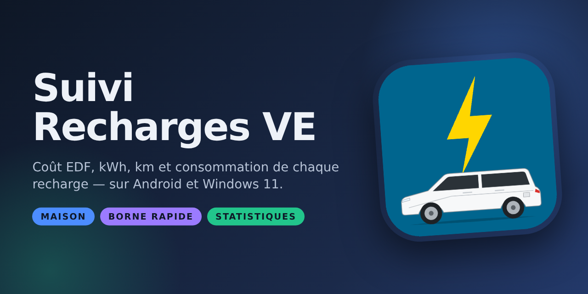
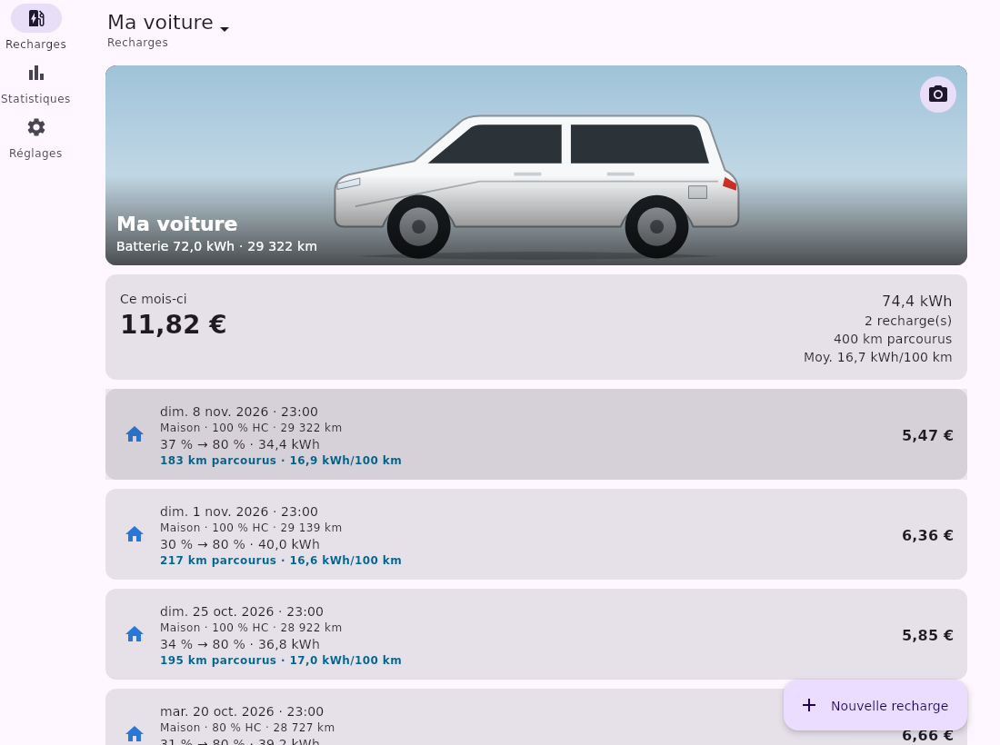
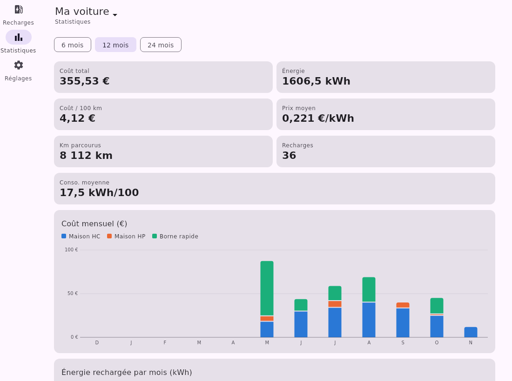
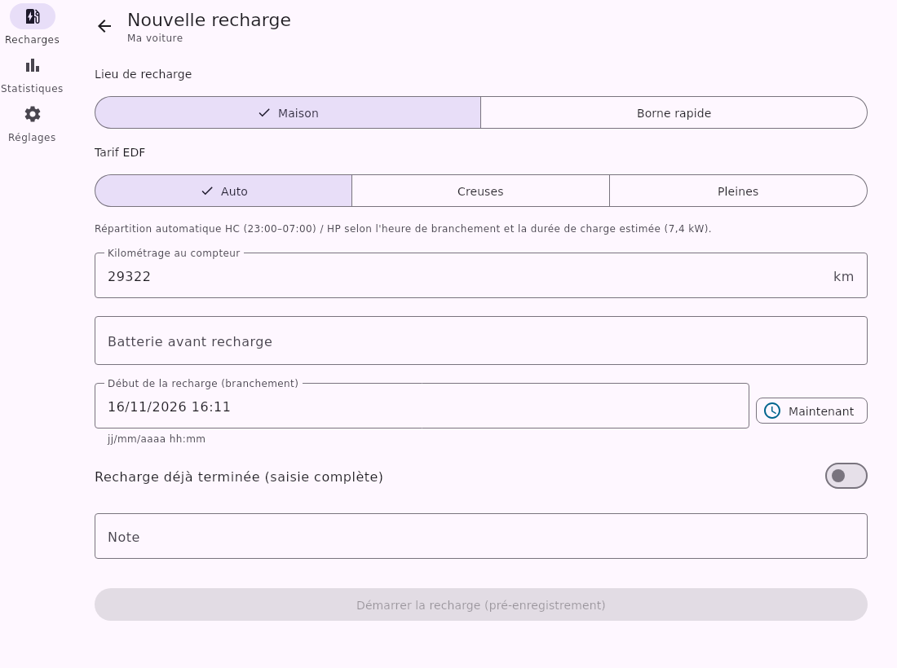
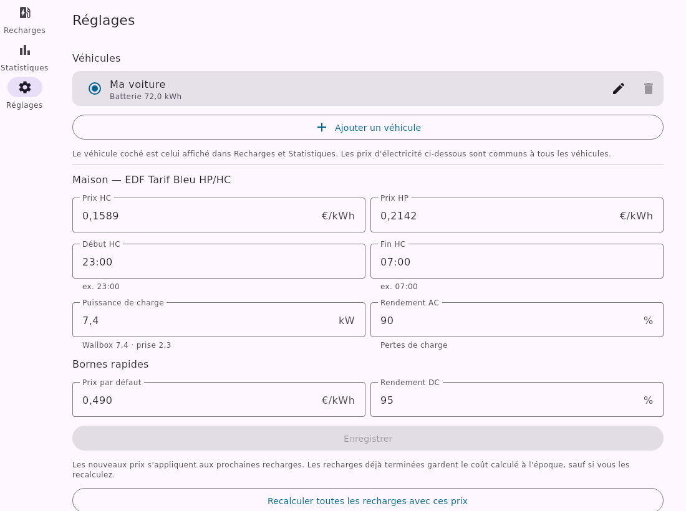

<h1 align="center">Suivi Recharges VE</h1>

<b>Suivez les recharges de votre voiture électrique : coût EDF, kWh, km parcourus et consommation.</b> 
Application gratuite pour <b>Android</b> et <b>Windows 11</b>, en français, sans publicité, sans compte à créer.

&nbsp;

&nbsp;

&nbsp;

&nbsp;

&nbsp;

&nbsp;

---

## ✨ Ce que fait l’application

| | |
|---|---|
| ⚡ **Suivre chaque recharge** | Kilométrage, % de batterie avant et après, à la maison ou sur borne rapide. On note au branchement, on termine quand c’est chargé. |
| 💶 **Connaître le coût exact** | Tarif EDF heures creuses / heures pleines calculé automatiquement (répartition selon l’heure de charge), ticket des bornes rapides. |
| 🔌 **Borne Legrand Green’Up Home** | Les kWh réellement mesurés par la borne et la durée de charge se remplissent tout seuls. |
| 🚗 **Voiture connectée** | Hyundai, Kia, Genesis : kilométrage et % de batterie lus depuis la voiture (accès officiel du règlement européen EU Data Act). |
| 📊 **Statistiques** | Coût, kWh, km parcourus et consommation aux 100 km, mois par mois, en graphiques et en tableau. |
| 🚙 **Plusieurs véhicules** | Chaque voiture a ses recharges, sa capacité de batterie, sa photo et ses statistiques. |
| 🔄 **Téléphone ↔ PC** | Synchronisation automatique par un fichier dans votre cloud (kDrive, OneDrive…). Export / import CSV compatible Excel. |

## 📸 Aperçu

Captures de la version Windows, avec des données d’exemple. La version Android a les mêmes écrans.

## 📥 Installation rapide

**Android** (8.0 ou plus récent)
1. Téléchargez [SuiviRechargesVE-Android.apk](https://github.com/guerinbruno1-wq/suivi-recharges-ve/releases/latest/download/SuiviRechargesVE-Android.apk) depuis le téléphone.
2. Ouvrez le fichier ; autorisez « Installer des applis inconnues » si Android le demande.
3. Appuyez sur « Installer ».

**Windows 11**
1. Téléchargez [SuiviRechargesVE-Windows.msi](https://github.com/guerinbruno1-wq/suivi-recharges-ve/releases/latest/download/SuiviRechargesVE-Windows.msi).
2. Double-cliquez. Si « Windows a protégé votre ordinateur » s’affiche : **Informations complémentaires** → **Exécuter quand même**.
3. Lancez « Suivi Recharges VE » depuis le menu Démarrer.

Une nouvelle version s’installe **par-dessus** l’ancienne : vos recharges sont conservées.

➡️ Réglages de la voiture et de la borne, utilisation au quotidien : **[mode d’emploi complet](MODE_EMPLOI.md)** (aussi en [PDF](Mode-emploi-Suivi-Recharges-VE.pdf)).

## 🗂️ Toutes les versions

Chaque version, avec ses fichiers et ses nouveautés, est sur la page **[Releases](https://github.com/guerinbruno1-wq/suivi-recharges-ve/releases)**. Le détail est dans l’[historique des versions](CHANGELOG.md).

## 🔒 Vos données restent chez vous

L’application ne collecte rien : vos recharges, réglages et codes d’accès restent **sur votre appareil** (et, si vous activez la synchronisation, dans **votre** cloud). Pas de compte, pas de publicité, pas de statistiques d’usage. Détails : [règles de confidentialité](https://guerinbruno1-wq.github.io/suivi-recharges-ve/confidentialite.html).

## 💬 Une question, un problème ?

Ouvrez un ticket dans l’onglet **[Issues](https://github.com/guerinbruno1-wq/suivi-recharges-ve/issues)** de ce dépôt.

Application indépendante, non affiliée à EDF, Legrand, Netatmo, Hyundai, Kia ou Genesis. Les noms de marques ne sont cités que pour indiquer la compatibilité.
